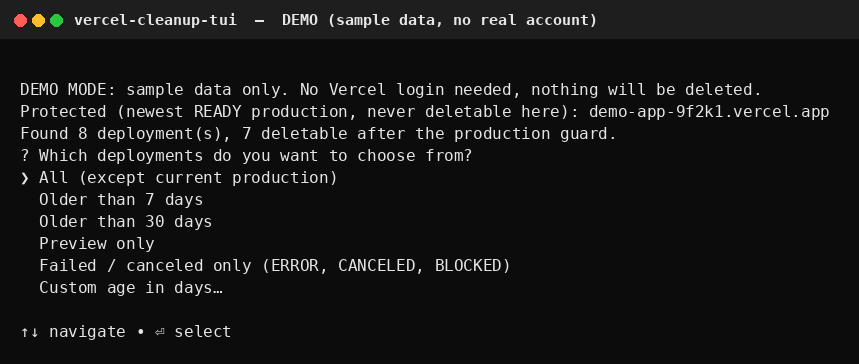
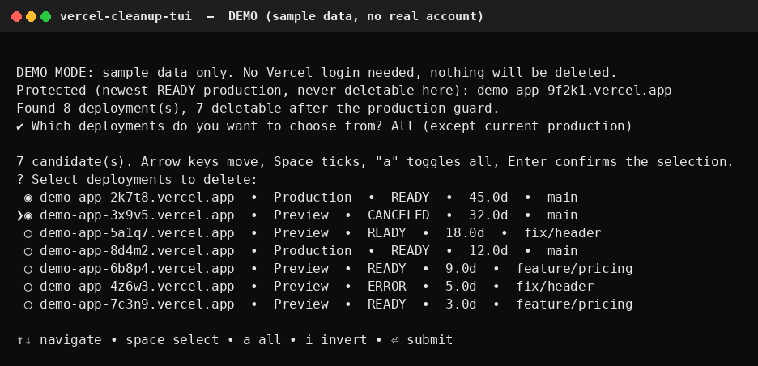
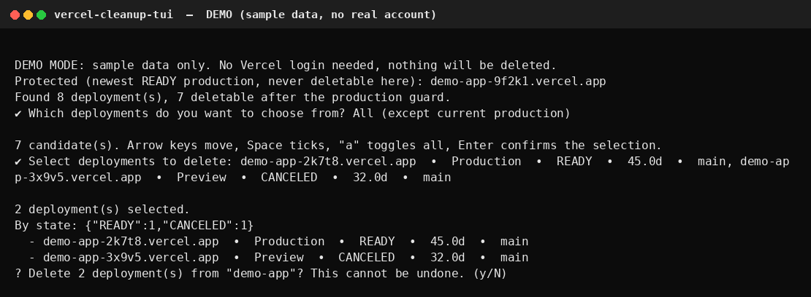
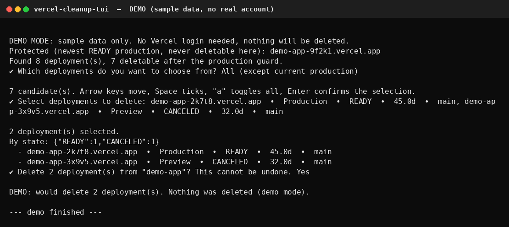

# vercel-cleanup-tui — Bulk-Delete Old Vercel Deployments from Your Terminal

**Vercel deployment cleanup, the easy way:** an interactive terminal (TUI)
tool that lists your Vercel deployments and lets you bulk-delete the old
ones with arrow keys and Space — no typing deployment URLs one by one,
no Vercel API token, no server, no hosting. It simply wraps the Vercel
CLI you already logged in with, on your own machine. Windows + Linux.

Arrow keys move, Space ticks/unticks, `a` toggles all, Enter confirms.

## Why this exists

The Vercel dashboard deletes deployments one by one. The Vercel CLI can
delete many at once, but only if you type every URL yourself. This tool
puts a checkbox list in your terminal instead.

## The important part: no token, no data leaves your PC

1. Run `vercel login` once, in your own terminal.
2. This tool only shells out to that same `vercel` CLI on the same
   machine (`vercel ls --json`, `vercel remove <url> --yes`).
3. It never asks for a Vercel API token, never stores one, and never
   sends your data to any server. There is nothing for the author to
   host, and nothing for the author to see.

## Requirements

- Node.js 20.17+ (or 22 / 24)
- Vercel CLI, already logged in:

```bash
npm install -g vercel
vercel login
```

Works in Windows PowerShell, Windows Command Prompt, VS Code's
terminal, macOS Terminal, and Linux terminals — anywhere the Vercel
CLI runs.

## Install and run

```bash
# From the published package (after publishing):
npx vercel-cleanup-tui

# Or from a clone:
git clone <your-repo-url>
cd vercel-cleanup-tui
npm install
npm start
```

Pass a project name to skip the first prompt:

```bash
npx vercel-cleanup-tui my-project
npx vercel-cleanup-tui my-project --scope my-team
npx vercel-cleanup-tui my-project --dry-run   # list only, delete nothing
```

## Screenshots (demo mode, sample data only)

These are real terminal captures of `vercel-cleanup --demo demo-app`.
They show sample URLs, not a real Vercel account's deployments.
Real-account screenshots can replace them later with no code change.






Try it yourself, no login needed:

```bash
npx vercel-cleanup-tui --demo demo-app
```

Full feature list: [FEATURES.md](FEATURES.md).

## Flow

1. Preflight: checks `vercel whoami`. If you are not logged in, it
   stops and tells you to run `vercel login`.
2. Project: type the project name, or pass `--project`.
3. Fetch: `vercel ls <project> --json --limit 100`, paging with
   `--next` until all deployments are listed.
4. Protection: the newest READY production deployment is protected.
   It is shown, but never offered for deletion.
5. Filter: all, older than 7 days, older than 30 days, preview only,
   failed/canceled only, or a custom age in days.
6. Select: checkbox list, oldest first. Nothing is pre-ticked —
   press `a` to toggle all, Space to tick individual rows.
7. Confirm: a summary, then a confirm prompt (default: no).
8. Re-check: the list is fetched fresh. If the current production
   deployment changed since you selected, the run aborts and deletes
   nothing. Already-gone deployments are skipped.
9. Delete: in batches of 20, by deployment URL only, with `--yes`.

## Safety rules

- **Never `vercel remove <project-name>`.** That deletes the whole
  project. This tool only ever passes deployment URLs to
  `vercel remove`, never a project name.
- **The newest READY production deployment is never deletable here.**
  Older production deployments *are* deletable if you tick them —
  deleting one removes that rollback target, so tick them deliberately.
- **Deletion cannot be undone.** Vercel does not restore deleted
  deployments. Use `--dry-run` first on a project you care about.
- **Never parse the `vercel ls` text table in scripts.** When piped,
  the table goes to stderr and a bare URL list goes to stdout, which
  corrupts table parsing. This tool uses `--json` and epoch
  millisecond ages only.
- If a delete batch fails or hangs, do not blindly re-run it.
  Re-list first and see what actually remains — a batch can delete
  some deployments server-side even when its confirmation output
  never arrives.

## Development

```bash
npm install
npm test        # node --test test/cli.test.js, no extra test framework
node --check cli.js
```

## License

MIT. See [LICENSE](LICENSE).
